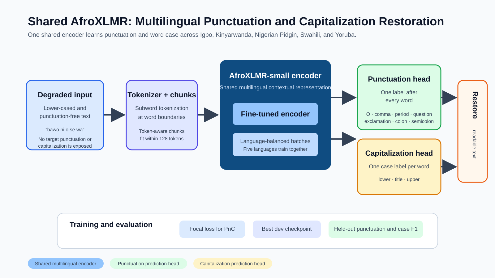

# Multilingual African Punctuation and Capitalization Restoration

A shared multilingual system that restores punctuation and word casing for **Igbo**, **Kinyarwanda**, **Nigerian Pidgin**, **Swahili**, and **Yoruba**.

It is one component of an offline spoken information pipeline:

> speech / ASR transcript → punctuation and capitalization restoration → domain classification → local, grounded answer



## Current result

The completed baseline fine-tunes `Davlan/afro-xlmr-small` on a held-out clean-text restoration task. One shared model learns punctuation and capitalization jointly across all five languages.

| Held-out test metric | Score |
|---|---:|
| **Punctuation macro-F1, excluding `O`** | **0.4910** |
| Punctuation macro-F1, including `O` | 0.5583 |
| **Capitalization macro-F1** | **0.8741** |
| Period F1 | 0.8444 |
| Colon F1 | 0.7202 |
| Comma F1 | 0.5446 |
| Question F1 | 0.5259 |

`O` means *no punctuation after a word*. It is excluded from the primary punctuation score because it is the most common label; otherwise a model predicting no punctuation everywhere would appear artificially strong.

The eight-epoch run selected the best development checkpoint at **epoch 7**. On the same held-out split, it improved the earlier five-epoch result from **0.4768** to **0.4910** punctuation macro-F1 excluding `O`.

> These are clean-text restoration results. Input text is deterministically lower-cased and stripped of punctuation. The project does not yet claim performance on noisy ASR transcripts or a downstream domain-classification improvement.

## Data used in the evaluated baseline

Raw corpora, model checkpoints, and generated predictions are kept local and excluded from version control. The following is the exact data version used for the reported result.

| Stage | Records | What happened |
|---|---:|---|
| Raw source records screened | 9,122,890 | Five language-specific corpora were checked for length, casing, terminal punctuation, and control characters. |
| Strict candidates selected | 87,330 | Deterministic, language-balanced selection; source caps made the first experiment manageable. |
| Losslessly reconstructible records | 60,085 | Retained only when word, punctuation, and case labels recreated the reference text exactly. |
| Training records | **48,055** | Used to fine-tune the shared model. |
| Development records | 5,979 | Used to select the best checkpoint. |
| Held-out test records | 6,051 | Used for the reported score. |

The test partition produced 6,621 token-aware chunks. The length audit found **zero over-budget chunks**, so labels were not silently dropped through truncation.

### Records by language

| Language | Strict candidates | Accepted supervision | Train | Dev | Test |
|---|---:|---:|---:|---:|---:|
| Igbo | 20,000 | 14,297 | 11,460 | 1,437 | 1,400 |
| Kinyarwanda | 20,000 | 18,809 | 15,037 | 1,881 | 1,891 |
| Nigerian Pidgin | 10,871 | 5,135 | 4,094 | 530 | 511 |
| Swahili | 20,000 | 14,514 | 11,628 | 1,409 | 1,477 |
| Yoruba | 16,459 | 7,330 | 5,836 | 722 | 772 |
| **Total** | **87,330** | **60,085** | **48,055** | **5,979** | **6,051** |

### Data cleaning and label quality

Raw text is never overwritten. The pipeline normalizes Unicode and whitespace while preserving language-specific characters. A record is accepted only when its labels round-trip exactly to the reference text.

This excludes malformed rows such as unsupported mixed casing, punctuation-only tokens, embedded punctuation that the current label scheme cannot represent safely, and unresolved reconstruction mismatches. The result is a smaller but reproducible quality-controlled training set.

## Implementation

- **Encoder:** `Davlan/afro-xlmr-small`, fine-tuned as one shared multilingual encoder.
- **Input:** lower-cased, punctuation-free words derived separately from the original reference.
- **Punctuation head:** `O`, comma, period, question, exclamation, colon, and semicolon.
- **Capitalization head:** lower, title, and upper case.
- **Imbalance handling:** focal loss for punctuation.
- **Language balance:** language-balanced sampling.
- **Length handling:** token-aware chunks bounded to 128 tokens at word boundaries.
- **Checkpoint selection:** development punctuation macro-F1 excluding `O`.

## Reproducing the baseline

```powershell
conda activate idlf26
python -m pip install -r requirements-train.txt
$env:PYTHONPATH = "src"

python scripts\train_baseline.py `
  --config configs\afroxlmr_small_expanded_v1_8epoch.json `
  --data-dir data\processed\supervised_expanded_v1 `
  --output-dir outputs\afroxlmr_small_expanded_v1_8epoch
```

Audit token-aware segmentation first:

```powershell
python scripts\audit_token_lengths.py `
  --config configs\afroxlmr_small_expanded_v1_8epoch.json `
  --data-dir data\processed\supervised_expanded_v1 `
  --output data\interim\token_length_audit_expanded_v1.json
```

## Next data version

A larger, provenance-tracked corpus of 11.8 million rows is available locally for the next experiment. The frozen-evaluation expansion workflow will add more high-confidence training data while preserving the current development and test sets. See [RUN_NEW_DATA_EXPANSION.md](RUN_NEW_DATA_EXPANSION.md).

## Limitations

- This result demonstrates multilingual **text restoration**, not real-ASR robustness.
- Rare labels remain difficult: exclamation F1 is 0.2447 and semicolon F1 is 0.0664.
- A direct comparison of raw ASR text versus PnC-restored text is needed before claiming a benefit to domain classification or spoken QA.
- Raw data, model weights, outputs, and external credentials are intentionally not committed.

## References

- Alam, T., Khan, A., & Alam, F. (2020). *Punctuation Restoration using Transformer Models for High- and Low-Resource Languages*.
- Courtland, M., Faulkner, A., & McElvain, G. (2020). *Efficient Automatic Punctuation Restoration Using Bidirectional Transformers with Robust Inference*.
- Alabi, J. O., Adelani, D. I., Mosbach, M., & Klakow, D. (2022). *Adapting Pre-trained Language Models to African Languages via Multilingual Adaptive Fine-Tuning*.
